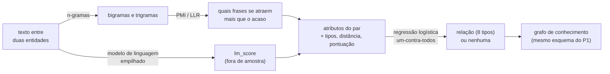
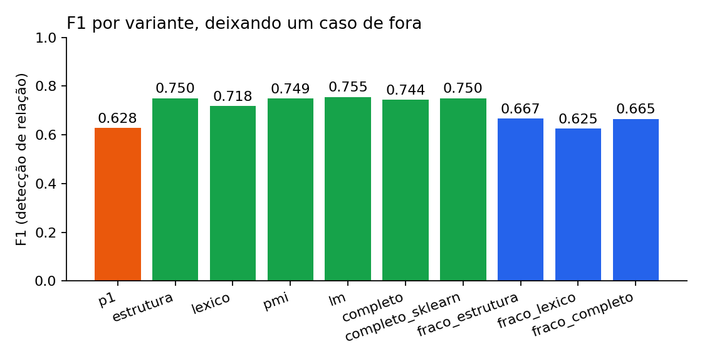
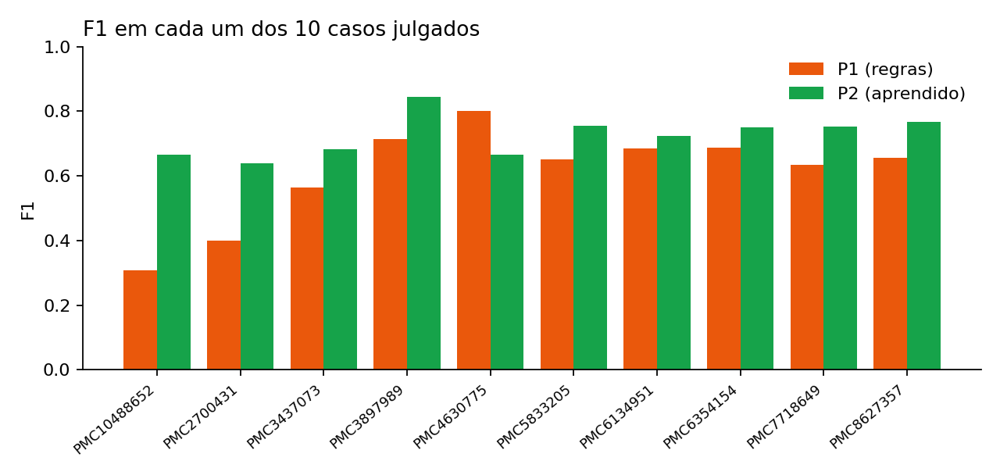
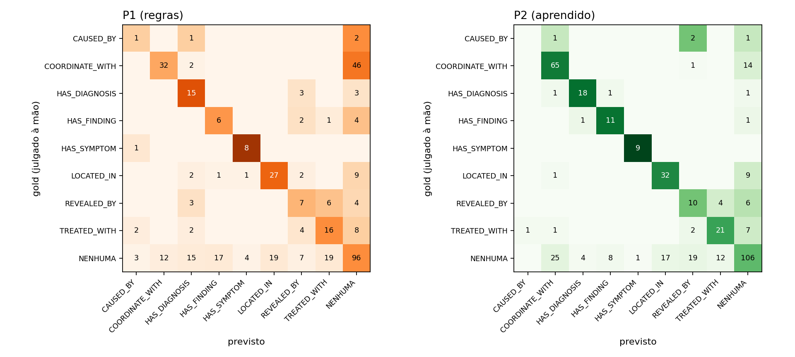
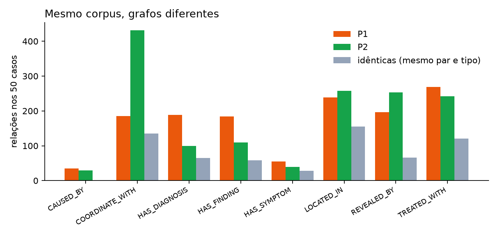
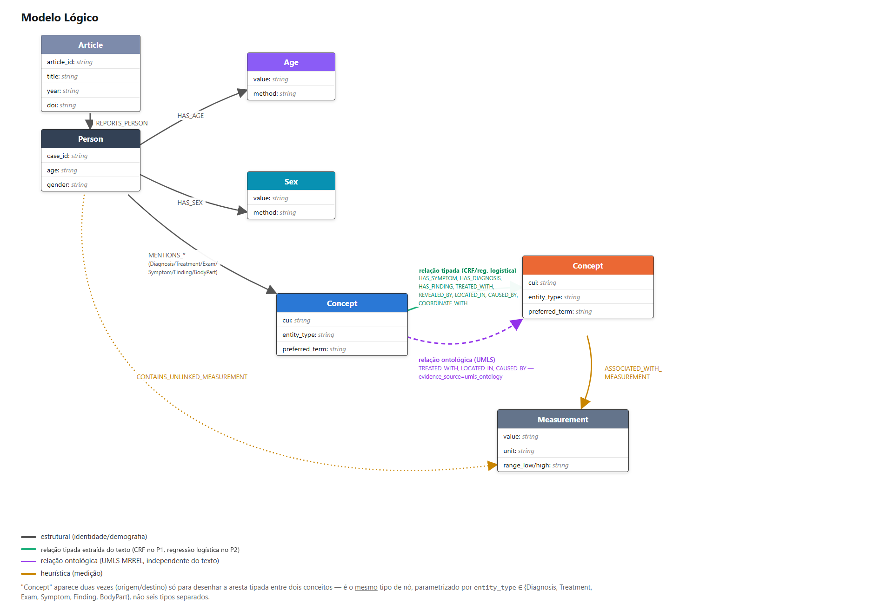
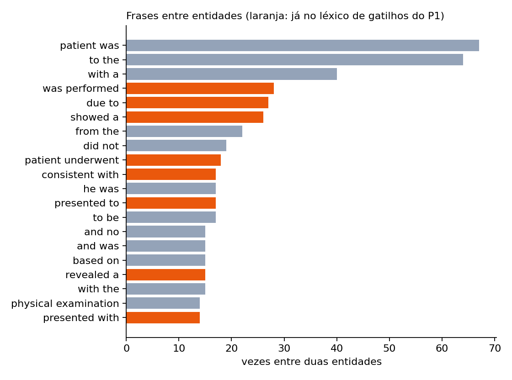

# Extração de Relações Clínicas com N-gramas, PMI e Regressão Logística
# Clinical Relation Extraction with N-grams, PMI and Logistic Regression

## Slides

Apresentação em PDF: [`assets/slides/projeto2_slides.pdf`](assets/slides/projeto2_slides.pdf).

Versão no Canva: <https://www.canva.com/design/DAHYaPqW5x4/EmjVc4YbHl_ZNceaWqWFmw/edit>

## Demonstração Executável

* **Caderno executado, com as saídas salvas** (o GitHub o exibe direto no navegador):
  [`pipelines/notebooks/projeto2.ipynb`](pipelines/notebooks/projeto2.ipynb). Conta o projeto na ordem
  n-gramas → PMI → modelo de linguagem → regressão logística → comparação com o Projeto 1.
* **Tudo regenerado com um comando** (cerca de 6 minutos; `--rapido` pula a supervisão fraca e leva ~1 minuto;
  não precisa do gazetteer UMLS):

  ```bash
  bash run_all.sh            # tabelas -> treinar -> extrair -> comparar   (ou: make p2)
  bash run_all.sh --rapido   # sem a supervisão fraca (a parte lenta)
  ```

  A execução rápida invalida a tabela anterior de supervisão fraca, evitando
  que a interface misture resultados de execuções diferentes.

* **Visualizador interativo** dos grafos do P1 (regras), do P2 (aprendido) e da comparação, com cada aresta
  colorida pelo método que a produziu:

  ```bash
  PYTHONPATH=src python -m streamlit run src/clinical_kg/app/projeto2.py     # ou: make app-p2
  ```

  Casos do corpus usam os arquivos já extraídos. A opção *Caso novo (ao vivo)* aceita um texto colado e o passa
  pelo gazetteer UMLS e pelos dois métodos; ela exige o `gazetteer.db` (ver [`src/README.md`](src/README.md)).

## Metodologia

**Ponto de partida.** O Projeto 1 extraiu um grafo de conhecimento de 50 relatos de caso do MultiCaRe
(entidades via gazetteer UMLS) e decidia se havia relação entre duas entidades com um CRF de pesos escritos à
mão e um léxico de 140 gatilhos. O Projeto 2 pergunta se **estatística e aprendizado de máquina clássico**,
sem LLMs, embeddings nem Transformers, decidem melhor, e se o grafo muda.

**O que não muda (controle do experimento).** Os pares candidatos são os do Projeto 1, sem alteração, e as
entidades e o `assertion_status` (negação, hipótese, histórico) também. Os dois sistemas veem exatamente os
mesmos pares: qualquer diferença vem de **quem decide**.



1. **N-gramas.** Sequências de *n* palavras do texto entre duas entidades ("was treated with"). Com 81,7% dos
   bigramas do corpus aparecendo uma única vez, estatísticas ingênuas enganam, o que motiva as duas etapas
   seguintes.
2. **PMI e LLR** (Church & Hanks, 1990; Dunning, 1993). O PMI compara a frequência de um bigrama com a esperada
   ao acaso; o LLR mede a mesma associação sem supor contagens grandes. O PMI vale zero abaixo de 5 ocorrências,
   para não premiar pares vistos uma vez:

   ```python
   def pmi(self, a, b):
       c = self.bigramas.get((a, b), 0)
       if c < self.contagem_minima:
           return 0.0
       return math.log2((c / self.total) / ((self.unigramas[a] / self.total_palavras)
                                            * (self.unigramas[b] / self.total_palavras)))
   ```

3. **Modelo de linguagem e empilhamento** (Jurafsky & Martin; Wolpert, 1992). Dois modelos bigrama com
   suavização add-k, um sobre os pares com relação e outro sobre os sem, condensam os n-gramas em **um número**
   (`lm_score`). Para que a regressão não veja um sinal inflado, cada exemplo é pontuado por modelos treinados
   **sem o seu caso**:

   ```python
   for caso in casos:                       # validação cruzada por caso, não por exemplo
       dentro = [e for e in exemplos if e.caso == caso]
       fora = [e for e in exemplos if e.caso != caso]
       pontuador = PontuadorLM(**parametros).ajustar(fora)
       for e in dentro:
           saida[e.chave] = pontuador.pontuar(e.entre)
   ```

4. **Regressão logística, escrita à mão** (SGD, penalidade L2 nos atributos ativos), uma por relação (um-contra-todos), com os
   atributos: tipos das entidades, distância, pontuação, `pmi_max`, `pmi_medio`, `llr_max` e `lm_score`.
   Uma versão do scikit-learn serve só de verificação. O peso da classe rara nunca passa do número de seus
   exemplos positivos (ver *Resultados*).
5. **Ablação do uso direto dos n-gramas.** Cada frase de 1 a 3 palavras do texto entre as entidades, vista em
   pelo menos 2 pares de treino, vira um atributo binário. Serve só para medir (não alimenta o grafo): responde se
   o uso mais direto dos n-gramas faria melhor do que a versão comprimida.
6. **Supervisão fraca** (*Possibilidade 4* da guia do professor). O mesmo modelo, treinado **sem nenhum
   julgamento humano**: as regras do Projeto 1 rotulam todos os 2.391 candidatos dos 50 casos (o tipo que
   propõem se o `score` passa do limiar, senão "nenhuma") e o modelo aprende com esses rótulos dos **outros 49
   casos**; a prova é o gold do caso retirado, que nunca entra no treino. Responde às perguntas da guia: o modelo
   reproduz as regras? generaliza? acha o que as regras perderam? reduz falsos positivos? E dá aos n-gramas 6
   vezes mais dados do que no treino com o gold.
7. **Avaliação.** 413 pares julgados à mão em 10 casos (o *gold*, construído no Projeto 1). Validação **deixando
   um caso de fora**: em cada rodada, o modelo, as contagens de PMI e os modelos de linguagem são refeitos sem o
   caso de teste, então nenhum número é medido sobre texto que o modelo já leu.

### Confronto com Trabalho Anterior

O confronto compara o Projeto 1 (regras) com o Projeto 2 (aprendido) em três níveis.

**1. Experimental, no gold** (413 pares, validação deixando um caso de fora):

| Variante | Precisão | Cobertura | F1 | Tipo certo | F1 por caso | Casos vs P1 (V-E-D) |
|---|---|---|---|---|---|---|
| **P1 (regras à mão)** | 0,602 | 0,656 | 0,628 | 0,772 | 0,610 ± 0,142 | — |
| P2 só estrutura | 0,671 | 0,851 | 0,750 | 0,894 | 0,725 ± 0,078 | 9-0-1 |
| P2 + n-gramas diretos (frases como atributos) | 0,716 | 0,719 | 0,718 | 0,925 | 0,665 ± 0,166 | 7-0-3 |
| P2 + PMI/LLR | 0,678 | 0,837 | 0,749 | 0,908 | 0,731 ± 0,071 | 9-0-1 |
| P2 + modelo de linguagem | 0,679 | 0,851 | 0,755 | 0,888 | 0,726 ± 0,081 | 9-0-1 |
| **P2 completo** | 0,679 | 0,824 | 0,744 | 0,912 | 0,725 ± 0,059 | 9-0-1 |
| P2 completo (scikit-learn) | 0,663 | 0,864 | 0,750 | 0,895 | 0,733 ± 0,060 | 9-0-1 |
| *Supervisão fraca:* só estrutura | 0,581 | 0,783 | 0,667 | 0,780 | 0,647 ± 0,084 | 7-0-3 |
| *Supervisão fraca:* n-gramas diretos | 0,597 | 0,656 | 0,625 | 0,779 | 0,623 ± 0,103 | 4-1-5 |
| *Supervisão fraca:* completo | 0,584 | 0,769 | 0,664 | 0,788 | 0,641 ± 0,093 | 7-0-3 |

As três últimas linhas se treinam com as **etiquetas das regras do P1** (49 casos, sem gold); as demais, com o gold.




**Matriz de confusão dos tipos de relação** (gold na linha, previsto na coluna; `NENHUMA` = sem relação; as mesmas
previsões fora de amostra da tabela, em [`metricas_matriz_confusao.csv`](data/processed/metricas_matriz_confusao.csv)):



* **Relações perdidas** (coluna `NENHUMA`): o P1 perde 46 das 80 `COORDINATE_WITH` do gold; o P2 perde 14.
* **Tipo trocado** (fora da diagonal, excluindo `NENHUMA`): o P1 troca o tipo de 33 relações detectadas e o P2 de 16.
  A confusão mais comum do P1 é `REVEALED_BY` lida como `TREATED_WITH` (6 casos).
* **Falsas relações** (linha `NENHUMA`): 96 do P1 e 86 do P2. As mais comuns no P2 são `COORDINATE_WITH` (25) e
  `REVEALED_BY` (19); no P1, `LOCATED_IN` e `TREATED_WITH` (19 cada) e `HAS_FINDING` (17).
* **`CAUSED_BY`** (4 exemplos): o P2 não acerta nenhuma (ver *Resultados*), o P1 acerta 1.

**2. No grafo, nos 50 casos** (mesmas entidades, quem decide é o que muda):

| | P1 | P2 |
|---|---|---|
| Relações únicas (cabeça, cauda, tipo) | 1.352 | 1.442 |
| Idênticas nos dois (mesmo par e tipo) | 623 | 623 (Jaccard 0,29) |
| Arestas do grafo agregado por conceito | 1.299 | 1.380 (605 idênticas, Jaccard 0,29) |
| Grau médio dos nós conectados | 1,68 | 1,71 |



**3. Qualitativo.** No gold, fora de amostra: os dois acertam 158 pares, **só o P2 acerta 114**, só o P1 acerta
50 e os dois erram 91 (exemplos reais em
[`data/processed/comparacao_exemplos.csv`](data/processed/comparacao_exemplos.csv)). O P2 recupera muito mais
listas de achados (`COORDINATE_WITH`: 185 → 427) e menos `HAS_DIAGNOSIS`/`HAS_FINDING`, que o P1 dispara como
categoria de reserva.

**Intervalos de confiança.** Com 10 casos, "ganha em 9 de 10" precisa de um intervalo. Fez-se um *bootstrap
pareado por caso* (10.000 repetições: sorteiam-se casos com reposição, o mesmo sorteio para os dois métodos, e
calcula-se a diferença de F1; o intervalo de 95% são os percentis 2,5 e 97,5). Resultado
([`metricas_bootstrap.csv`](data/processed/metricas_bootstrap.csv)):

| Diferença de F1 (A − B) | Diferença | IC 95% | Distinguível de zero? |
|---|---|---|---|
| P2 completo − P1 | +0,118 | [+0,079, +0,165] | **sim** |
| P2 só estrutura − P1 | +0,124 | [+0,083, +0,175] | **sim** |
| P2 n-gramas diretos − P1 | +0,090 | [+0,012, +0,165] | sim |
| P2 completo − só estrutura | −0,006 | [−0,025, +0,015] | não |
| P2 + PMI − só estrutura | −0,001 | [−0,020, +0,021] | não |
| P2 + modelo de linguagem − só estrutura | +0,004 | [−0,010, +0,018] | não |
| P2 n-gramas diretos − só estrutura | −0,034 | [−0,097, +0,027] | não |
| Fraco completo − P1 | +0,037 | [−0,005, +0,081] | não |
| Fraco só estrutura − P1 | +0,040 | [+0,007, +0,075] | sim |
| Fraco n-gramas diretos − P1 | −0,001 | [−0,037, +0,041] | não |
| Fraco n-gramas diretos − fraco só estrutura | −0,041 | [−0,059, −0,016] | **sim (pior)** |
| Fraco completo − P2 completo (gold) | −0,081 | [−0,121, −0,043] | **sim (pior)** |

**Como ler isso, com honestidade.**

* O modelo aprendido supera as regras de forma consistente: F1 de 0,63 para ~0,75 (diferença de +0,12, com
  intervalo de 95% inteiramente acima de zero), acerto do tipo de 0,77 para ~0,91, e vitória em 9 dos 10 casos.
* **As variantes com PMI e modelo de linguagem não se distinguem da variante só de estrutura.** Ficam entre 0,744 e
  0,755 de F1, com desvio entre casos de 0,06 a 0,08. Contra a de estrutura, o PMI ganha em 4 casos e perde em 4, o
  modelo de linguagem em 3 e 3, e o completo ganha em 4 e **perde em 6**.
* **O uso direto dos n-gramas também não ajudou.** Com cada frase de 1 a 3 palavras como atributo, o F1 fica em
  0,718 (a estimativa é menor que a de estrutura, mas o intervalo da diferença inclui o zero) e o desvio entre
  casos sobe (0,166); perde para a variante só de estrutura em 7 dos 10 casos. A
  precisão e o tipo certo sobem (0,72 e 0,93) porque o modelo passa a disparar menos (cobertura 0,72). Nem
  `REVEALED_BY`, a relação mais dependente de uma palavra-gatilho, melhora de forma relevante (F1 0,36 → 0,38), e
  `TREATED_WITH` piora (0,58 → 0,47).
* O ganho vem sobretudo dos atributos estruturais (tipos de entidade, distância, pontuação) e de ter um
  classificador treinado, não dos n-gramas, nem comprimidos (PMI, modelo de linguagem) nem diretos.
* **Supervisão fraca: com mais dados, os n-gramas fazem o modelo imitar as regras, não superá-las.** Treinado só
  com as etiquetas do P1 (2.391 candidatos), o modelo com n-gramas diretos fica em F1 0,625, igual ao do P1
  (0,628), e **concorda com as decisões do P1 em 85,5%** dos pares, contra 77,5% do modelo só de estrutura:
  as frases aprendem o léxico de gatilhos que as regras já usavam. Mas isso o torna *pior* que a variante só de
  estrutura (−0,041, intervalo que não inclui zero), porque também memoriza os erros das regras. O treino com
  o gold (413 julgamentos humanos) supera o treino com 2.391 etiquetas das regras (−0,081 para o fraco completo).

## Trabalhos Estudados

* **Church & Hanks (1990)** introduzem o PMI para medir associação entre palavras e extrair colocações; é a
  base de nossa medida de atração entre bigramas. Sua limitação conhecida (pares raros ganham PMI altíssimo)
  explica o corte de contagem mínima que adotamos.
* **Dunning (1993)** propõe a razão de verossimilhança (LLR) para estatísticas de surpresa em dados esparsos,
  onde o qui-quadrado falha; a usamos ao lado do PMI porque nosso corpus é pequeno.
* **Jurafsky & Martin, *Speech and Language Processing*** (capítulos de n-gramas, suavização e regressão
  logística) são a referência do curso para o modelo de linguagem bigrama com add-k e para a regressão logística
  que implementamos.
* **Wolpert (1992)** descreve o empilhamento (*stacked generalization*): a saída de modelos de nível 0, obtida
  fora de amostra, vira atributo de um modelo de nível 1. É o que justifica calcular o `lm_score` sem o caso do
  próprio exemplo.
* **MultiCaRe (Nievas Offidani & Delrieux, 2024)** é o conjunto de relatos de caso de que partimos, e
  **UMLS (Bodenreider, 2004)** o vocabulário controlado do gazetteer que reconhece as entidades.

Não comparamos com modelos neurais ou de Transformers, que o enunciado exclui.

## Modelo Lógico

O modelo de grafo é o do Projeto 1 e **não muda**: o P2 altera apenas quem decide as arestas tipadas entre
conceitos (as de `TREATED_WITH`, `LOCATED_IN`, `HAS_DIAGNOSIS` etc.).



* **Nós:** `Article`, `Person`, `Age`, `Sex`, `Concept` (um por CUI, com `entity_type`) e `Measurement`.
* **Relações do texto:** `HAS_SYMPTOM`, `HAS_DIAGNOSIS`, `HAS_FINDING`, `TREATED_WITH`, `REVEALED_BY`,
  `LOCATED_IN`, `CAUSED_BY` e `COORDINATE_WITH`, cada uma com `assertion_status`.
* **O que o P2 acrescenta às arestas:** no P2 o `score` da aresta é a **probabilidade** dada pelo modelo (no P1
  era a pontuação das regras), o gatilho do P1 é apagado, e o visualizador marca a `origem` da aresta (`p1`,
  `p2` ou `ambos`) na vista de comparação.

## Análises que podem ser realizadas

Valem as do Projeto 1 (co-ocorrência diagnóstico–tratamento, pacientes com achados em comum, filtro por
`assertion_status` etc.), agora também sobre o grafo aprendido, e:

* **Comparar métodos**: quais arestas só um dos métodos encontra, por tipo e por caso, e se as diferenças se
  concentram em certos tipos (listas de achados, diagnósticos).
* **Filtrar por confiança**: no P2 o `score` é uma probabilidade; cortar arestas com baixa confiança troca
  cobertura por precisão.
* **Listas de achados**: `COORDINATE_WITH` permite reconstruir enumerações de sintomas, exames ou medicamentos.
* **Auditoria do que o modelo aprendeu**: os pesos da regressão (por relação) mostram quais atributos empurram
  para cada tipo.
* **Frases que sinalizam relação**: as frases mais frequentes entre duas entidades, e quais delas já estavam no
  léxico de gatilhos do P1 (52 das 140 palavras do léxico são confirmadas pelo corpus).

## Ferramentas

* **Python (biblioteca padrão)**: o núcleo do projeto (n-gramas, PMI, LLR, modelo de linguagem e regressão
  logística) é escrito à mão, sem dependências, para que cada fórmula seja auditável.
* **scikit-learn**: só verifica a regressão escrita à mão (resultados próximos, 0,744 contra 0,750 de F1).
* **Streamlit e Cytoscape.js**: visualizador dos grafos, com seletor P1/P2/comparação e caso novo ao vivo.
* **pandas e matplotlib**: tabelas do visualizador e as figuras (laranja = P1, verde = P2).
* **SQLite (gazetteer UMLS)**: reconhecimento de entidades, herdado do P1; licenciado e fora do git.
* **nbformat e nbclient**: executam o caderno para guardá-lo com as saídas.
* **Testes**: 131 testes (`make test`, ou `PYTHONPATH=src python3 -m unittest discover -s tests`), incluindo o do empilhamento, que verifica que
  o score de um exemplo não depende do próprio rótulo.

## Resultados

* **Aprender supera escrever regras**: F1 de 0,628 para 0,744–0,755 e tipo acertado de 0,772 para até 0,912, com
  vitória em 9 dos 10 casos. Ganhos grandes em `HAS_DIAGNOSIS` (F1 0,49 → 0,82), `HAS_FINDING` (0,32 → 0,67),
  `COORDINATE_WITH` (0,52 → 0,75) e `HAS_SYMPTOM` (0,73 → 0,95).
* **Mesmo corpus, grafos diferentes**: só 623 das ~1.400 relações coincidem (Jaccard 0,29), o que confirma a
  advertência de que métricas parecidas podem esconder grafos distintos.



* **N-gramas e PMI: o que dizem os dados.** Usar as frases diretamente como atributos (a variante mais óbvia)
  não melhorou o F1 (0,750 → 0,718, diferença que o bootstrap não distingue de zero): com 413 exemplos, milhares
  de frases viram parâmetros sem evidência. O topo do PMI são termos clínicos ("pleural effusion"), não gatilhos;
  os gatilhos têm PMI baixo porque são palavras frequentes. O `lm_score` separa as classes dentro da amostra
  (0,26 contra −0,15) e **quase não separa fora dela** (0,08 contra 0,03), por isso o empilhamento era necessário
  e por isso o ganho dos n-gramas é pequeno.
* **Supervisão fraca e n-gramas: a resposta da pergunta central.** Com as etiquetas do P1 em todos os candidatos
  dos 50 casos, a variante só de estrutura chega a F1 0,667, um pouco acima do P1 (+0,040, IC [+0,007, +0,075]), e
  mostra o que as regras perdem: **recupera 35 relações que o P1 não via** (perde 7), remove 11 falsos positivos
  das regras, mas introduz 40 novos. Os n-gramas diretos, agora com 6 vezes mais dados, **reproduzem o
  comportamento das regras** (F1 0,625, concordância de 85,5% com o P1) sem superá-las. Resposta honesta: os
  n-gramas capturam bem o léxico de gatilhos escrito à mão, mas, com etiquetas que vêm das próprias regras, não
  há de onde aprender algo além delas. Isso sugere (hipótese, não testada) que, para ir além das regras, fariam
  falta mais julgamentos humanos e não apenas mais texto.
* **Um achado: o peso da classe rara estragou `CAUSED_BY`.** Com 4 exemplos, o peso (positivos × negativos /
  positivos, teto 20) fazia o modelo disparar a relação em quase qualquer par: **99 arestas nos 50 casos contra 35
  do P1**, e F1 zero na validação. A correção é uma regra geral, não um remendo: o peso de uma classe nunca passa
  do número de seus exemplos positivos (`limitar_por_suporte`). Resultado: **31 arestas** e o tipo acertado sobe de
  0,89 para 0,91. Mas `CAUSED_BY` **nunca foi aprendida** em nenhuma configuração testada (pesos máximos de 1 a
  20): com 4 exemplos não há evidência. O ajuste foi escolhido olhando a mesma validação de 10 casos, o que
  dá um risco leve de superajuste.
* **UMLS como fonte de etiquetas: avaliada e descartada.** As relações do próprio UMLS (`MRREL`) já filtradas para
  o corpus são 213 (110 `TREATED_WITH`, 100 `LOCATED_IN`, 3 `CAUSED_BY`), mas só **10 dos 2.391 pares candidatos**
  (0,4%) têm alguma relação do UMLS entre seus dois conceitos. UMLS descreve conhecimento geral, não o que cada
  texto afirma, cobre só 3 dos 8 tipos e não traz negativos; por isso não serve para rotular os pares.
* **Sobre o conjunto de avaliação (*gold*).** Os 413 pares julgados vêm de 10 dos 50 casos e só incluem pares que
  o gerador de candidatos do Projeto 1 propôs; relações fora desse conjunto não são medidas. Além disso, os
  julgamentos foram feitos com apoio de um modelo de linguagem e revisados pela equipe. Por isso, os números de F1
  comparam os dois métodos sobre esse recorte, e não devem ser lidos como o desempenho em qualquer texto clínico.
* **Limitações.** Poucos dados (413 pares em 10 casos); o modelo final foi treinado com os pares de 10 dos 50
  casos, então as relações desses 10 são otimistas e as dos outros 40 são previsões reais; entidades e
  `assertion_status` continuam vindo do P1.

## Como Modelos de Linguagem foram Usados

* **No pipeline: só um modelo de linguagem estatístico clássico.** Um modelo de n-gramas (bigrama com
  suavização add-k), treinado por nós sobre o próprio corpus, gera o `lm_score`. **Não há LLMs, embeddings
  nem modelos Transformer** em nenhuma etapa da extração, conforme o enunciado.
* **No desenvolvimento: apoio de um assistente de IA.** O desenvolvimento do Projeto 2 contou com o apoio de um
  assistente de IA (Claude Code) em tarefas de implementação, depuração, revisão de código, escrita de testes e de
  documentação, sob a direção da equipe, que definia o plano, revisava cada etapa e aprovava cada alteração. O
  resultado foi corrigido e validado pela suíte de testes (126 testes) e pelos números reproduzíveis de
  `run_all.sh`.
* **Proveniência do gold.** Como descrito no README do Projeto 1, o conjunto de 413 pares julgados foi construído
  com o anotador interativo e **com apoio de um modelo de linguagem** na proposta dos julgamentos, revisada pela
  equipe. Os números de avaliação acima devem ser lidos com essa proveniência em mente.

## Referências Bibliográficas

* Church KW, Hanks P. Word Association Norms, Mutual Information, and Lexicography. *Computational
  Linguistics.* 1990;16(1):22-29. <https://aclanthology.org/J90-1003/>
* Dunning T. Accurate Methods for the Statistics of Surprise and Coincidence. *Computational Linguistics.*
  1993;19(1):61-74. <https://aclanthology.org/J93-1003/>
* Jurafsky D, Martin JH. *Speech and Language Processing*. 3rd ed. draft. Stanford University.
  <https://web.stanford.edu/~jurafsky/slp3/>
* Wolpert DH. Stacked Generalization. *Neural Networks.* 1992;5(2):241-259.
  <https://doi.org/10.1016/S0893-6080(05)80023-1>
* Nievas Offidani M, Delrieux C. Dataset of clinical cases, images, image labels and captions from open access
  case reports from PubMed Central (1990–2023). *Data in Brief.* 2024;52:110008.
  <https://doi.org/10.1016/j.dib.2023.110008>
* Bodenreider O. The Unified Medical Language System (UMLS): integrating biomedical terminology. *Nucleic
  Acids Research.* 2004;32(Database issue):D267-D270. <https://doi.org/10.1093/nar/gkh061>
