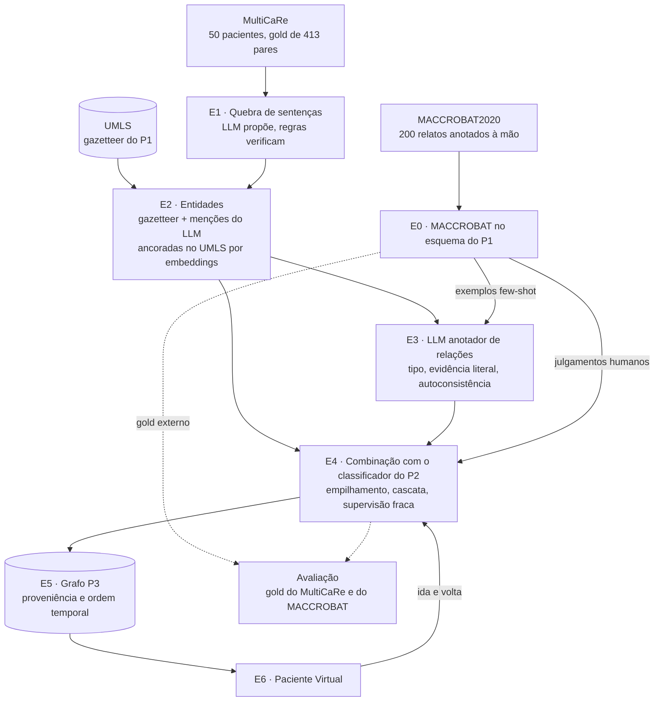
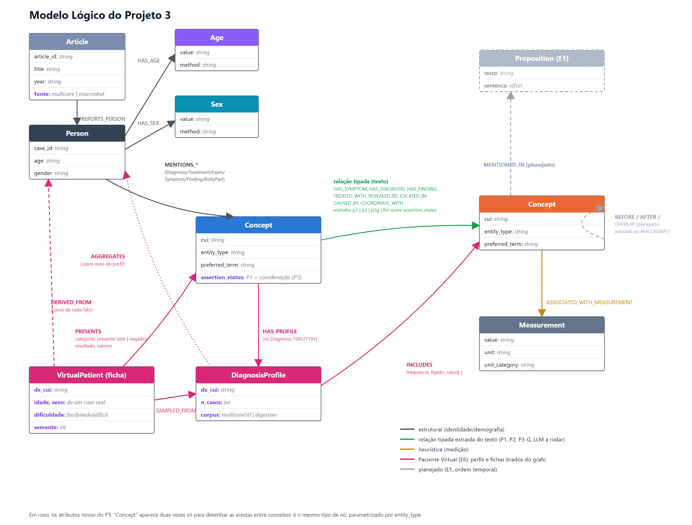
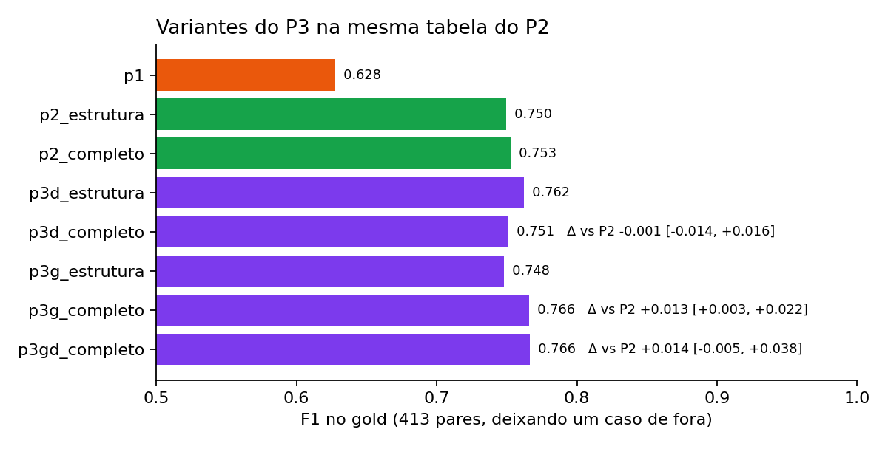
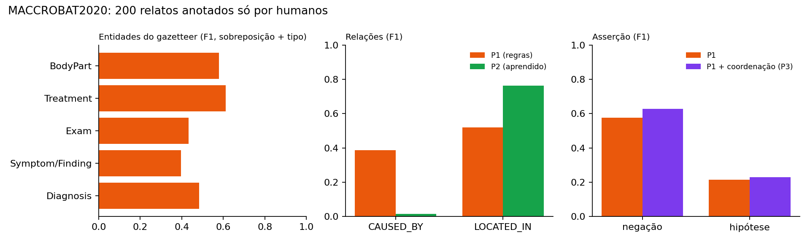
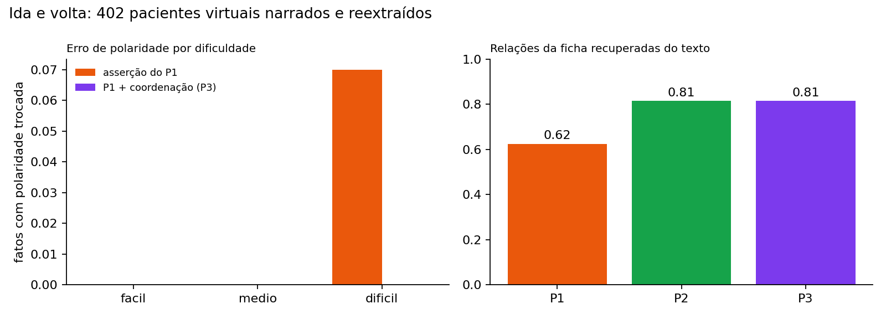
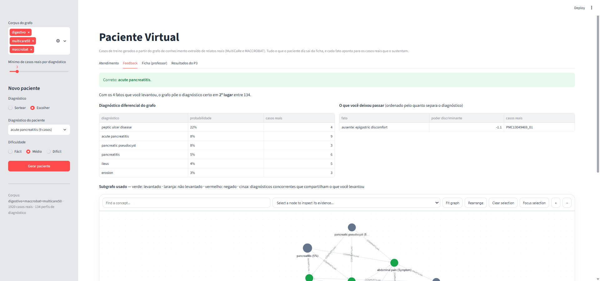
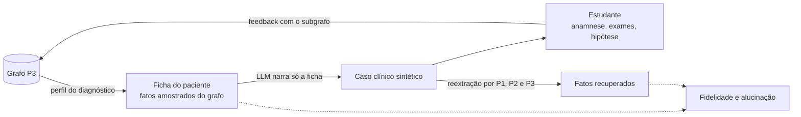

# Extração Híbrida de Conhecimento Clínico com Modelos de Linguagem e Pacientes Virtuais
# Hybrid Clinical Knowledge Extraction with Language Models and Virtual Patients

## Slides

*(a preencher)* PDF em `assets/slides/`.

## Demonstração Executável

```bash
cd project3
pip install -r requirements.txt            # + scikit-learn, matplotlib, pyarrow, sentence-transformers
make p3                                    # MACCROBAT -> externo -> treinar -> extrair -> figuras (sem UMLS, sem LLM)
make app-p3                                # Paciente Virtual (lê os corpora já construídos em data/processed/app/)
```

Sem `make` (Windows), cada alvo é um comando `python -m ...` com `PYTHONPATH=src` (ver `Makefile`). Os alvos
marcados *(UMLS)* no `Makefile` (`p3-etapas`, `p3-corpus`, `p3-ida-volta`) precisam do gazetteer completo, apontado
por `CLINICAL_KG_GAZETTEER`; seus resultados já estão em `data/processed/`.

* **Aplicação Paciente Virtual** (Streamlit + Cytoscape.js, sucessora do visualizador do P2):
  `src/clinical_kg/app/projeto3.py`. Não precisa do gazetteer nem de LLM.
* **Variantes com LLM:** `make p3-llm-avaliar` lê só o cache de respostas (`data/interim/cache/llm_cache.jsonl`),
  então os números se refazem **sem chave de API**; `python -m clinical_kg.llm.pipeline anotar` preenche o cache
  com qualquer endpoint compatível com a API da OpenAI (inclusive o Ollama local).
* **Caderno executado** `pipelines/notebooks/projeto3.ipynb`: percorre o projeto inteiro com o código ao vivo
  (MACCROBAT, P3-G refeito com bootstrap, LLM com provedor falso, paciente virtual, ida e volta), sem chave de API.
  As células que pedem o gazetteer UMLS caem nos resultados gravados quando ele não está disponível.
* Testes: `PYTHONPATH=src python -m pytest tests` (150 testes; os do P3 em `tests/test_p3.py`, sem rede nem UMLS).

## Metodologia

### Ponto de partida e perguntas

O Projeto 1 extraiu um grafo de conhecimento de 50 relatos de caso do MultiCaRe com regras (gazetteer UMLS e um CRF
de pesos escritos à mão). O Projeto 2 mostrou que um classificador treinado com 413 julgamentos humanos supera as
regras (F1 0,628 → 0,753), mas deixou duas questões em aberto:

* **`CAUSED_BY` nunca foi aprendida**: o gold tem 4 exemplos, e nenhuma configuração a acertou;
* a hipótese, não testada, de que **"para ir além das regras, fariam falta mais julgamentos humanos e não apenas
  mais texto"**: treinado com as etiquetas das próprias regras, o modelo só as imitou.

O Projeto 3 testa essa hipótese com duas fontes novas de julgamento, **anotadores humanos de outro corpus
(MACCROBAT)** e **um modelo de linguagem grande (LLM)**, e usa o LLM **combinado** com as técnicas anteriores
(regras, classificador e ontologia), não no lugar delas. Três perguntas guiam o trabalho:

1. **Extração.** Combinado com o classificador do P2 e com o UMLS, o LLM extrai relações melhor do que as regras
   (P1) e o aprendizado clássico (P2)? Em quais tipos, e a que custo em chamadas ao modelo?
2. **Dados.** O que leva mais longe: julgamentos humanos de outro corpus ou julgamentos gerados por um LLM
   (supervisão fraca)?
3. **Aplicação.** Um grafo de conhecimento, com um LLM restrito a ele, gera pacientes virtuais fiéis ao grafo e
   úteis para treinar raciocínio clínico?

### O que não muda (controle do experimento)

Como no P2: os 50 pacientes, os 2.391 pares candidatos, o gold de 413 pares em 10 casos (221 relações de 8 tipos),
a validação deixando um caso de fora e o bootstrap pareado por caso. **Toda variante do P3 entra como uma nova linha
da mesma tabela do P2.** Nas comparações de relações, as entidades e o `assertion_status` continuam os do P1; as
etapas que mudam as entidades (E1 e E2) são medidas à parte, no MACCROBAT. Exemplos few-shot tirados do gold vêm só
dos casos de treino de cada rodada, para que o caso de teste nunca apareça no prompt.

### Visão geral



### Etapas

**E0 · O MACCROBAT no esquema do P1.** Um leitor do formato brat (entidades `T`, eventos `E`, relações `R`,
simultaneidade `*` e atributos `A`) converte os 200 relatos para o esquema de entidades e relações do P1. O
mapeamento abaixo foi contado sobre os arquivos do MACCROBAT2020:

| MACCROBAT | P1/P2 | Anotações |
|---|---|---|
| `Disease_disorder` | Diagnosis | 1.362 |
| `Sign_symptom` | Symptom e Finding (o MACCROBAT não separa os dois) | 3.382 |
| `Diagnostic_procedure` | Exam | 4.598 |
| `Medication`, `Therapeutic_procedure` | Treatment | 1.080 + 1.036 |
| `Biological_structure` | BodyPart | 2.953 |
| `Lab_value`, `Dosage` | Measurement | 2.848 + 361 |
| `POLARITY=NEG`; `UNCERTAIN` e `MAYBE_*` | `assertion_status` negado; hipotético | 1.049; 221 |
| `CAUSE` | `CAUSED_BY` | 149 |
| `MODIFY` com `Biological_structure` como modificador | `LOCATED_IN` | 3.006 |
| `MODIFY` de `Lab_value` para `Diagnostic_procedure` | ligação exame → valor (etapa 4 do P1) | 2.747 |
| `MODIFY` de `Dosage`, `Administration` ou `Frequency` para `Medication` | ligação medicamento → dose | 553 |
| `IDENTICAL` | correferência (P1) | 795 |
| `BEFORE`, `AFTER`, `OVERLAP` | ordem temporal (**nova** no P3) | 2.014; 398; 2.023 grupos |

O MACCROBAT dá o que o P1 e o P2 nunca tiveram: um gold **humano e externo** para a etapa de entidades e para a
negação, e 149 relações causais, 37 vezes os 4 exemplos de `CAUSED_BY` do gold. Os documentos são nomeados por
PMID, e **14 dos 200 também estão no MultiCaRe** (cruzamento com o `pmid` dos 76.137 artigos da versão 3.0.1): se o
texto se alinhar, esses 14 viram um gold humano sobre o próprio texto do MultiCaRe (alinhamento a verificar).

**E1 · Quebra de sentenças com LLM** (atividade *Breaking Sentences* da disciplina). Frases clínicas empacotam
vários fatos ("...erythrocyte sedimentation rate of 120 mm/h, C-reactive protein of 91 mg/dl, a white blood cell
count of 28,000/mm3..."). O LLM reescreve cada sentença como proposições atômicas, um fato por linha, e uma regra
verifica cada proposição: todo número e toda palavra de conteúdo dela têm de estar na sentença original, senão ela é
descartada. As proposições formam a "árvore de conhecimento" sentença → proposição → conceito. Medida: os 2.747
vínculos exame → valor e os 553 medicamento → dose do MACCROBAT, comparando a etapa de medidas do P1 rodando sobre
o texto original e sobre as proposições.

**E2 · Entidades: gazetteer + LLM, ancorados no UMLS.** O gazetteer do P1 continua; o LLM propõe as menções que ele
não encontra (variações, abreviações, paráfrases). Cada proposta é ligada ao UMLS em dois passos: candidatos por
TF-IDF de 3-gramas de caracteres sobre os nomes do gazetteer (como no scispaCy) e reordenação por similaridade de
embeddings SapBERT, treinados justamente para aproximar sinônimos do UMLS. A menção só entra se a similaridade passar
de um limiar e se o tipo semântico (TUI) for compatível com a categoria proposta: **o LLM nunca cria um conceito fora
da ontologia**. Medida: precisão e cobertura contra as entidades do MACCROBAT (trecho exato e com sobreposição).

**E3 · LLM como anotador de relações.** Para cada par candidato, o LLM recebe a sentença com as duas entidades
marcadas, a definição dos 8 tipos e exemplos few-shot escolhidos por similaridade de embeddings (os mais parecidos
com o par, não uma lista fixa), vindos do gold dos casos de treino e, para `CAUSED_BY` e `LOCATED_IN`, do MACCROBAT.
Contrato de saída (proposto):

~~~json
{"par": 17, "relacao": "CAUSED_BY", "assercao": "affirmed",
 "evidencia": "pneumonia secondary to aspiration", "confianca": 0.8}
~~~

Regras disciplinam a resposta: o tipo tem de ser compatível com as categorias das duas entidades (por exemplo,
`LOCATED_IN` exige uma BodyPart) e a evidência tem de ser um trecho literal da sentença.

~~~python
def resposta_valida(r, sentenca, tipos_do_par):
    return r["relacao"] in tipos_do_par and r["evidencia"] in sentenca  # senão, a resposta é descartada
~~~

A confiança não é a que o modelo declara: é a **autoconsistência**, a fração de *k* amostras que concordam no tipo.
Toda resposta fica em cache (chave = hash do prompt), o que torna o experimento reprodutível e permite relatar o
custo exato em chamadas.

**E4 · Combinação: onde o "híbrido" acontece.** Todas as variantes são medidas no mesmo gold e com o mesmo
protocolo:

| Variante | Ideia | De onde vêm os julgamentos de treino |
|---|---|---|
| P3-A · LLM zero-shot | o LLM decide sozinho | — |
| P3-B · LLM few-shot | exemplos recuperados por similaridade | gold (casos de treino) e MACCROBAT |
| P3-C · P2 + LLM (empilhamento) | voto e confiança do LLM viram atributos da regressão do P2 | gold |
| P3-D · P2 + embeddings | vetor do texto entre as entidades como atributo | gold |
| P3-E · Cascata | o LLM só arbitra os pares em que P1 e P2 discordam | gold |
| P3-F · Supervisão fraca com LLM | o LLM rotula os 2.391 candidatos e o P2 aprende com isso | LLM |
| P3-G · Transferência do MACCROBAT | o P2 treina com o gold + as relações mapeadas do MACCROBAT | humanos, 2 corpora |

* **P3-C** repete o desenho do `lm_score` do P2 (empilhamento fora de amostra, Wolpert 1992), agora com um LLM no
  nível 0.
* **P3-E** é a variante barata. No gold, em 164 dos 413 pares só um dos dois métodos acerta (114 o P2, 50 o P1): um
  árbitro perfeito ali levaria o P2 de 272 para 322 pares certos. Esse é o teto da cascata.
* **P3-F e P3-G respondem à pergunta 2.** P3-F repete a supervisão fraca do P2 trocando as regras pelo LLM como
  rotulador; P3-G dá ao P2 mais julgamentos humanos, de outro corpus (os 149 `CAUSE` atacam o `CAUSED_BY`).

**E5 · Grafo P3.** O esquema do P1 continua, com três acréscimos (ver *Modelo Lógico*): cada aresta guarda o
método que a produziu, a confiança e a evidência; eventos do mesmo paciente ganham ordem temporal; e pacientes
virtuais entram como nós ligados aos fatos de onde vieram. Para a aplicação, o grafo é construído sobre um **recorte
maior do MultiCaRe** (uma especialidade, escolhida pelos termos MeSH) com os extratores baratos, sem LLM: nos 50
casos, 230 dos 297 conceitos de diagnóstico (77%) aparecem em um único paciente, e um paciente virtual montado ali
seria a cópia de um caso real.

**E6 · Paciente Virtual.** A aplicação, descrita em *Resultados → Aplicação*, gera casos a partir do grafo e
devolve o texto gerado aos extratores (ida e volta), o que fecha o ciclo grafo → texto → grafo.

### Confronto com Trabalho Anterior

Intervalos de 95% do bootstrap pareado por caso (10.000 reamostragens). Tabelas completas em
`data/processed/resultados/`; figuras em `assets/images/p3_*.png`.

**1. Gold do MultiCaRe** (413 pares, deixando um caso de fora; `make p3-treinar`):

| Variante | Julgamentos de treino | Precisão | Cobertura | F1 | Tipo certo | Δ F1 vs P2 [IC 95%] |
|---|---|---|---|---|---|---|
| P1 (regras à mão) | — | 0,602 | 0,656 | 0,628 | 0,772 | −0,126 [−0,180, −0,084] |
| P2 completo | gold | 0,687 | 0,833 | 0,753 | 0,913 | — |
| P2 supervisão fraca (do P2) | etiquetas das regras do P1 | 0,595 | 0,783 | 0,676 | 0,786 | |
| P3-A · LLM zero-shot | — | | | | | *(a preencher)* |
| P3-B · LLM few-shot | gold (casos de treino) | | | | | *(a preencher)* |
| P3-C · P2 + LLM | gold | | | | | *(a preencher)* |
| P3-D · P2 + embeddings | gold | 0,694 | 0,819 | 0,751 | 0,917 | −0,001 [−0,014, +0,016] |
| P3-E · Cascata | gold | | | | | *(a preencher)* |
| P3-F · Supervisão fraca com LLM | etiquetas do LLM | | | | | *(a preencher)* |
| **P3-G · P2 + MACCROBAT** | gold e MACCROBAT | 0,682 | 0,873 | **0,766** | 0,886 | **+0,013 [+0,003, +0,022]** |
| P3-G + P3-D | gold e MACCROBAT | 0,686 | 0,869 | 0,766 | 0,885 | +0,014 [−0,005, +0,038] |

P1 e P2 são recalculados na mesma execução das variantes do P3, então as diferenças são comparáveis; os números
coincidem com os do README do P2 (resultados regenerados no PR #8). A linha da supervisão fraca vem do P2
(`fraco_completo`) e não foi recalculada aqui.

**2. Gold externo do MACCROBAT** (anotação só humana; mede a generalização para fora do MultiCaRe; `make p3-externo`
e `make p3-etapas`). Nas relações, as entidades são as do gold, para isolar a decisão de relação:

| Tarefa | Anotações | P1 | P2 | P3 (sem LLM) | LLM |
|---|---|---|---|---|---|
| Entidades nas 6 categorias (F1, sobreposição + tipo) | 14.383 | 0,491 | = P1 | = P1 | *(E2)* |
| Entidades (F1, trecho exato + tipo) | 14.383 | 0,337 | = P1 | = P1 | *(E2)* |
| Negação (F1) | 1.004 | 0,577 | = P1 | **0,628** (+0,051 [+0,031, +0,072]) | |
| Hipótese/incerteza (F1) | 217 | 0,215 | = P1 | 0,229 | |
| `LOCATED_IN` (F1) | 2.800 | 0,519 | **0,765** | treina nele | |
| `CAUSED_BY` (F1) | 113 | 0,388 | 0,016 | treina nele | |
| Exame → valor: valor achado / ligado ao exame certo | 1.173 numéricos | 0,596 / 0,866 | = P1 | = P1 | *(E1)* |
| Medicamento → dose: dose achada / ligada certo | 282 numéricas | 0,901 / 0,874 | = P1 | = P1 | *(E1)* |

As relações anotadas que o gerador de candidatos do P1 nunca propõe ficam fora: ele propõe 81% dos `LOCATED_IN` e
69% dos `CAUSED_BY` anotados (coluna `teto_do_gerador`). O vínculo de valores cai para 0,458 (exames) e 0,594
(doses) com as entidades do gazetteer no lugar das do gold: o gargalo é reconhecer o exame, não ligar o valor.

**3. Grafos nos 50 casos** (`make p3-extrair`; relações iguais = mesmo par e mesmo tipo):

| Relação | P1 | P2 | P3 | Jaccard P2–P3 | Jaccard P1–P3 |
|---|---|---|---|---|---|
| `CAUSED_BY` | 35 | 31 | 15 | 0,000 | 0,064 |
| `COORDINATE_WITH` | 185 | 427 | 429 | 0,959 | 0,282 |
| `HAS_DIAGNOSIS` | 189 | 101 | 100 | 0,990 | 0,290 |
| `HAS_FINDING` | 184 | 110 | 110 | 1,000 | 0,246 |
| `HAS_SYMPTOM` | 55 | 39 | 39 | 1,000 | 0,424 |
| `LOCATED_IN` | 239 | 259 | 322 | 0,674 | 0,424 |
| `REVEALED_BY` | 196 | 234 | 261 | 0,847 | 0,169 |
| `TREATED_WITH` | 269 | 241 | 242 | 0,980 | 0,310 |
| **Total** | 1.352 | 1.442 | 1.518 | 0,859 | 0,289 |

O P3 muda sobretudo onde recebeu julgamentos novos: `LOCATED_IN` (+63 arestas) e `CAUSED_BY`, que troca
inteiramente (nenhuma das 15 coincide com as 31 do P2). `REVEALED_BY` muda por tabela (+27): no um-contra-todos
vence a classe mais confiante, então mexer em dois modelos binários desloca pares vizinhos.

## Trabalhos Estudados

Base bibliográfica do plano, a aprofundar:

* **Caufield et al. (2019)** propõem o sistema de tipos ACROBAT e anotam com ele o MACCROBAT, nossa segunda fonte:
  relatos do PubMed Central com entidades, eventos, relações e ordem temporal.
* **Agrawal et al. (2022)** mostram que LLMs extraem informação clínica com poucos exemplos e sem treino específico,
  inclusive em tarefas de saída estruturada como extração de relações. É a base do LLM anotador (E3).
* **Liu et al. (2022)** mostram que exemplos few-shot escolhidos por similaridade com a entrada superam exemplos
  aleatórios; é como escolhemos os exemplos do E3.
* **Wang et al. (2023)** propõem a autoconsistência: amostrar várias respostas e ficar com a mais votada. Usamos a
  fração de votos como confiança do LLM, em vez da confiança que ele declara.
* **Wolpert (1992)** descreve o empilhamento, já usado no P2 para o `lm_score`; no P3-C o nível 0 passa a ser o LLM.
* **Ratner et al. (2017)**, com o Snorkel, formalizam a supervisão fraca: criar dados de treino com rotuladores
  imperfeitos. O P2 usou as regras como rotulador; o P3-F usa o LLM.
* **Liu et al. (2021)** treinam o SapBERT para aproximar sinônimos do UMLS no espaço de embeddings, com o melhor
  resultado em seis bases de ligação de entidades médicas; é o reordenador do E2.
* **Neumann et al. (2019)**, no scispaCy, ligam menções ao UMLS por TF-IDF de 3-gramas de caracteres; é o nosso
  gerador de candidatos do E2.
* **Min et al. (2023)**, com o FActScore, decompõem texto gerado em fatos atômicos e verificam cada um contra uma
  fonte de conhecimento. Inspira a quebra de sentenças (E1) e a medida de alucinação do paciente virtual.
* **Gardent et al. (2017)**, no desafio WebNLG, geram texto a partir de triplas de um grafo. O paciente virtual é
  esse problema em domínio clínico, e a ida e volta avalia, no sentido texto → grafo, o que foi gerado no sentido
  grafo → texto.
* **Pan et al. (2024)** organizam a integração entre LLMs e grafos de conhecimento em duas direções que o projeto usa
  juntas: o LLM melhora o grafo (extração) e o grafo disciplina o LLM (paciente virtual). **Edge et al. (2024)**, no
  GraphRAG, usam um grafo extraído por LLM como índice que ancora a geração.
* **Cook & Triola (2009)** revisam os pacientes virtuais no ensino médico e apontam o desenvolvimento de raciocínio
  clínico como sua função mais singular, o que orienta a aplicação.
* **Tang et al. (2023)** treinam modelos clínicos menores com dados sintéticos gerados por LLM; motiva o experimento
  ousado de treinar o P2 com pacientes virtuais.

## Fonte de Dados Adicionais

**MACCROBAT2020** (fonte nova)

* **O que é:** 200 relatos de caso do PubMed Central (texto com uma sentença por linha) com anotação **manual** no
  formato brat. É a segunda versão do MACCROBAT2018, com anotações mais consistentes (Caufield et al., 2019).
* **Link:** <https://doi.org/10.6084/m9.figshare.9764942.v2> (licença CC BY 4.0).
* **Tamanho:** 4.541 sentenças; 25.189 trechos anotados em 41 tipos; 16.307 relações (`MODIFY` 11.571, `BEFORE`
  2.014, `SUB_PROCEDURE` 1.375, `IDENTICAL` 795, `AFTER` 398, `CAUSE` 149, `CO-OCCURRENCE` 5); 2.023 grupos de
  eventos simultâneos (`OVERLAP`); 1.270 marcas de negação ou incerteza.
* **Ponte com o MultiCaRe:** documentos nomeados por PMID; 14 dos 200 estão no MultiCaRe.
**Os quatro usos previstos no enunciado**, e qual fonte cobre cada um:

| Uso | Fonte | O que foi feito |
|---|---|---|
| 1. Dados complementares na extração (vocabulários e ontologias) | **UMLS 2026AA** | o gazetteer de ~1,1 milhão de termos reconhece as entidades e dá o CUI e o tipo semântico de cada uma em todos os corpora; os tipos semânticos também filtram os perfis da aplicação |
| 2. Análise em outro cenário | **MACCROBAT** | avaliação externa, com anotação só humana e esquema de outro grupo: relações, entidades, negação e medidas (*Confronto*, tabela 2) |
| 3. Treinamento | **MACCROBAT** | os pares `CAUSED_BY` e `LOCATED_IN` anotados treinam o classificador (P3-G, +0,013 de F1 com intervalo acima de zero) |
| 4. Fonte complementar para a aplicação | **MACCROBAT** | os 200 relatos entram no grafo do Paciente Virtual (abaixo) |

No uso 4, os 200 relatos passam pelo mesmo pipeline do MultiCaRe (gazetteer do P1 + modelo final do P3), para que os
CUIs casem e os perfis se somem; idade e sexo vêm dos trechos `Age` e `Sex` anotados à mão (191 e 190 dos 200).
Com eles, o grafo da aplicação passa de 1.720 para **1.920 casos** e de 124 para **134 perfis de diagnóstico**: 10
diagnósticos novos (entre eles insuficiência cardíaca, com 8 pacientes, 6 do MACCROBAT), e 36 perfis que já existiam
ganham pacientes (hipertensão, disfagia, cirrose…). Cada fato da ficha mostra de que caso real veio, e os do
MACCROBAT aparecem como `MACCROBAT_<pmid>`.

Ainda **não** usados, embora convertidos no E0: a ordem temporal anotada (`BEFORE`, `AFTER`, `OVERLAP`, para uma linha
do tempo do paciente) e exemplos do MACCROBAT no prompt few-shot do LLM (hoje os exemplos vêm só do gold).

**MultiCaRe completo** (versão 3.0.1, 98.641 casos de 76.137 artigos; os mesmos `cases.parquet` e
`metadata.parquet` do Zenodo que o caderno *Preparação de Dados* da disciplina usa): o recorte digestivo alimenta o
grafo da aplicação.

## Modelo Lógico



*(Gerada por `python -m clinical_kg.hibrido.modelo_logico`; o SVG está ao lado do PNG.)*

O modelo do P1/P2 continua (`Article`, `Person`, `Age`, `Sex`, `Concept`, `Measurement` e as 8 relações tipadas do
texto) e ganha, **implementado**:

* **Propriedades novas:** `fonte` do artigo (`multicare` ou `maccrobat`); `metodo` de cada relação tipada (`p1`, `p2`,
  `p3g` e, quando rodar, `llm`) com o seu `score`; e o `assertion_status` do P3 (escopo do P1 + propagação pela
  coordenação, seção *Resultados*).
* **`DiagnosisProfile`**: a agregação de um diagnóstico (só doença ou neoplasia) sobre os pacientes reais que o têm.
  `INCLUDES` liga o perfil a cada conceito, com a `frequencia`, se o grafo liga o fato ao diagnóstico (`ligado`) e
  os `casos` que o sustentam; `AGGREGATES` aponta para esses pacientes.
* **`VirtualPatient`** (a ficha): `SAMPLED_FROM` um perfil; `PRESENTS` cada fato, presente ou negado, com o resultado
  dos exames; `DERIVED_FROM` os pacientes reais de onde cada fato veio, o que mantém a proveniência até o texto.

**Planejado** (tracejado na figura): `Proposition`, a proposição atômica do E1, ligada às sentenças e aos conceitos
(a "árvore de conhecimento"); e `BEFORE`/`AFTER`/`OVERLAP` entre eventos do mesmo paciente, que o MACCROBAT anota
(2.412 relações temporais e 2.023 grupos simultâneos já convertidos no E0).

## Análises que podem ser realizadas

Valem as do P1 e do P2 e, com o grafo do P3:

* **Onde o LLM acrescenta e onde só imita:** concordância entre os três métodos por tipo de relação.
* **Calibração:** se a autoconsistência do LLM prevê o acerto (curva confiança × precisão).
* **Custo × ganho:** F1 por número de chamadas ao LLM (cascata contra LLM em todos os pares).
* **Trajetórias clínicas:** a sequência típica sintoma → exame → diagnóstico → tratamento de cada diagnóstico, pela
  ordem temporal.
* **Perfis de diagnóstico:** a vizinhança de um diagnóstico agregada sobre vários pacientes, e os diagnósticos que
  compartilham achados (o diferencial), base do paciente virtual.
* **Generalização:** quanto cada extrator perde ao sair do MultiCaRe para o MACCROBAT.

## Ferramentas

* **Python e o pacote `clinical_kg` do P1/P2**: gazetteer, pares candidatos, regressão logística, avaliação e
  bootstrap são reaproveitados. Módulos novos do P3:

  | Módulo | O que faz |
  |---|---|
  | `maccrobat/` | leitor brat, mapeamento para o esquema do P1 (E0) e avaliação externa das etapas do P1 |
  | `hibrido/` | pares do MACCROBAT, P3-G (transferência), P3-D (embeddings), asserção com coordenação, pipeline e figuras |
  | `llm/` | provedor configurável com cache, anotador de relações (E3) e as variantes P3-A, B, C, E e F |
  | `paciente/` | corpus da aplicação, perfis, ficha, narrador, diálogo, feedback e ida e volta (E6) |
  | `app/projeto3.py` | a aplicação Paciente Virtual |

* **LLM** com provedor configurável: qualquer endpoint compatível com a API de chat da OpenAI (API paga ou Ollama
  local), escolhido por variáveis de ambiente, com cache de respostas em disco. Modelo a definir.
* **sentence-transformers** com o `NeuML/pubmedbert-base-embeddings` (embeddings de sentença biomédicos) para o
  P3-D e para escolher exemplos few-shot. Planejado: SapBERT para a ligação ao UMLS (E2).
* **scikit-learn**: o nível 0 do P3-D (regressão logística sobre os embeddings).
* **Streamlit e Cytoscape.js**: a aplicação, herdeira do visualizador do P2.
* **pandas e pyarrow**: leitura do MultiCaRe completo (Parquet).
* **matplotlib**: figuras.
* **Leitor brat próprio** para o MACCROBAT: o formato é simples e não justifica uma dependência.

## Resultados



* **Mais julgamentos humanos, de outro corpus, ajudam (P3-G).** Treinar o classificador do P2 também com os pares
  `CAUSED_BY` e `LOCATED_IN` do MACCROBAT sobe o F1 de 0,753 para 0,766, com intervalo inteiro acima de zero
  ([+0,003, +0,022]) e vitória em 8 dos 10 casos. É a primeira evidência a favor da hipótese que o P2 deixou em
  aberto. O ganho vem de `LOCATED_IN` (32 → 35 acertos, cobertura 0,76 → 0,83).
* **Mas `CAUSED_BY` continua sem ser aprendida.** Mesmo com 149 exemplos causais humanos, o P3-G acerta 0 dos 4
  `CAUSED_BY` do gold e passa a disparar 18 falsos positivos. A forma de expressar causa difere entre os corpora, e
  os atributos estruturais do P2 (tipos, distância, pontuação) não a capturam: falta léxico, que é onde o LLM entra.
* **Embeddings de sentença não acrescentam (P3-D)** no protocolo do P2: −0,001 [−0,014, +0,016]. O nível 0 foi
  fixado antes de olhar o gold (C = 1); com C = 0,1 ou 10 o resultado também inclui o zero
  (`p3_sensibilidade_embeddings.csv`). Confirma o que o P2 viu com n-gramas: com 413 pares, informação léxica
  densa não supera os atributos estruturais.
* **Fora do MultiCaRe, o P2 generaliza onde aprendeu e falha onde não aprendeu.** No MACCROBAT, `LOCATED_IN` sobe de
  0,52 (P1) para 0,77 (P2), mas `CAUSED_BY` cai de 0,39 para 0,02: com 4 exemplos, o P2 desaprende o que as regras
  sabiam.
* **O reconhecimento de entidades é o gargalo.** As entidades do gazetteer acertam F1 0,49 (sobreposição e tipo) no
  MACCROBAT, e o vínculo valor → exame cai de 0,87 para 0,46 quando as entidades do gold dão lugar às do gazetteer.
  É o argumento para o E2 (menções propostas pelo LLM, ancoradas no UMLS).



#### A ida e volta encontrou e corrigiu um erro do P1



402 pacientes virtuais (134 diagnósticos × 3 dificuldades) foram narrados pelo narrador determinístico e
reextraídos (`make p3-ida-volta`):

| Medida | P1 | P2 | P3 |
|---|---|---|---|
| Fatos da ficha recuperados com a polaridade certa (fidelidade) | 0,965 | = P1 | **0,989** |
| Fatos com a polaridade trocada | 0,023 (0,070 no difícil) | = P1 | **0,000** |
| Conceitos extraídos fora da ficha (alucinação do extrator) | 0,007 | = P1 | = P1 |
| Relações da ficha recuperadas (par e tipo) | 0,624 | 0,815 | 0,815 |
| Relações da ficha com o par certo, qualquer tipo | 0,815 | 0,815 | 0,815 |

* **O erro de polaridade aparece só no difícil**, que é o nível com achados negados. Foi assim que o encontramos:
  em "She denied tenderness and dysuria", o P1 só nega a primeira entidade, porque o escopo de negação reinicia a
  cada oração e o segmentador corta a oração na conjunção.
* **A correção é uma regra de 10 linhas aplicada depois do P1** (`hibrido/assercao.py`): uma entidade separada da
  anterior só por coordenação ("," "and" "or") herda a negação dela. Nas fichas, a polaridade trocada vai a zero.
  **No MACCROBAT, anotado por humanos e nunca visto durante a correção, a F1 da negação sobe de 0,577 para 0,628
  (+0,051 [+0,031, +0,072], bootstrap por documento).** É o ciclo grafo → texto → grafo fazendo o que prometia:
  um texto gerado com gold por construção revelou um erro que o gold de 413 pares nunca mostrou, e a correção
  generalizou para dados reais.
* **O P1 acha o par mas erra o tipo**: recupera o par certo em 81% das relações esperadas, como o P2, mas só 62% com
  o tipo certo; o P2 acerta o tipo em todas as que acha. Reproduz, num texto de outra distribuição, o resultado do
  P2 no gold (tipo certo 0,77 → 0,91).
* P2 e P3 empatam na ida e volta porque as fichas não têm `CAUSED_BY` nem `LOCATED_IN`, as únicas relações em que
  o P3-G difere.
* *(a preencher)* O narrador LLM (`python -m clinical_kg.paciente.ida_volta --llm`): com ele, a mesma medida passa a
  avaliar também o quanto o LLM omite ou inventa.

**Custo em chamadas ao LLM** (`make p3-llm-estimar`): P3-A e P3-B, 413 cada (2.065 com autoconsistência k = 5);
P3-C, nenhuma a mais (usa os votos do P3-A); P3-E, 340 (só onde P1 e P2 discordam); P3-F, 2.391 (11.955 com k = 5).

### Aplicação




**Paciente Virtual**, um gerador de cenários de treino preso ao grafo. O grafo da aplicação vem de **1.920 casos
reais de duas fontes**: os 50 do P1 e um recorte de **1.674 casos digestivos do MultiCaRe** (artigos cujos termos
MeSH citam pâncreas, estômago, fígado, vias biliares, intestino etc.), mais os **200 relatos do MACCROBAT**, todos
passados pelo P1 e pelo modelo final do P3, sem LLM (`make p3-corpus`, ~14 min). Daí saem **134 perfis de
diagnóstico** com pelo menos 3 pacientes cada. Sem LLM
configurado, o paciente fala por frases-modelo; com ele, o LLM narra a ficha (o mesmo fluxo abaixo):



1. **Ficha do paciente.** Escolhe-se um diagnóstico (ou sorteia-se um) e um nível de dificuldade. Do grafo sai o
   *perfil do diagnóstico*: sintomas, achados, exames com valores e tratamentos ligados a ele nos vários pacientes
   reais que o têm, com a frequência de cada um. A ficha é uma amostra desse perfil (os fatos frequentes sempre; os
   raros, os distratores e os achados negados conforme a dificuldade), e cada fato guarda os casos reais que o
   sustentam.
2. **Atendimento.** O estudante pede a queixa principal, pergunta por sintomas (de um menu que mistura os da ficha
   com os dos diagnósticos concorrentes, para não entregar a resposta, ou em texto livre), examina e pede exames
   (idem). As respostas saem **só da ficha** ("I haven't noticed anything like that" para o resto); exames devolvem
   o que revelaram nos casos reais ou os valores de um paciente real ("lipase: 161 U/L"). Enquanto isso, a
   aplicação mostra o que o grafo "pensaria" com os mesmos fatos (Bayes ingênuo sobre os perfis).
3. **Hipótese e feedback.** O estudante propõe um diagnóstico; o sistema compara com o da ficha e mostra, no
   Cytoscape.js, o subgrafo usado: o que o estudante perguntou, o que deixou passar e o **diagnóstico diferencial**
   tirado do grafo (outros diagnósticos que compartilham os achados levantados), com os casos reais por trás de
   cada aresta.
4. **Ida e volta.** O caso narrado volta aos extratores P1, P2 e P3. Como a ficha é o gold *por construção*,
   mede-se a **fidelidade** (fatos da ficha recuperados) e a **alucinação** (fatos extraídos que não estavam na
   ficha); uma amostra revisada à mão separa o que é erro do gerador do que é erro do extrator. É uma métrica sem
   custo de anotação que avalia ao mesmo tempo o gerador e os três extratores, num texto de distribuição diferente.

**Filtros de qualidade da aplicação** (o P1 não muda; `paciente/perfil.py` e `paciente/corpus.py`). O gazetteer acha
conceitos UMLS válidos que não servem de fato clínico de um paciente virtual. Medimos e filtramos:
* "tratamentos" cujos valores ligados são de concentração de laboratório viram exames ("lipase 1572 U/L": 93 de 107
  valores da lipase; "prednisone 40 mg" tem massa e continua tratamento);
* diagnósticos de perfil só de doença ou neoplasia (TUI T047/T191), sem os vagos ("tumor", "syndrome");
* achados (T033, o tipo "cesta" do UMLS) só se o grafo os usa como fato clínico (cauda de relação afirmada em ≥ 2
  casos), sem números ("5 mm"), particípios soltos ("detected") e termos vagos;
* conceitos presentes em mais de 25% dos casos ("CT", "surgery") ficam fora dos perfis;
* fatos raros exigem 2 pacientes; valores de exame vêm de um único paciente; idade e sexo, do mesmo paciente real.

Restam termos vagos que escapam aos filtros: é a limitação de um grafo extraído por regras, e um motivo para o E2.

## Como Modelos de Linguagem foram Usados

Planejado:

* **Quebra de sentenças** em proposições atômicas, verificadas por regras (E1).
* **Proposta de menções de entidades**, sempre ancoradas no UMLS (E2).
* **Anotação de relações**: zero-shot, few-shot, árbitro da cascata e rotulador da supervisão fraca (E3 e E4).
* **Embeddings**: SapBERT para ligar menções ao UMLS; embeddings de sentenças para escolher exemplos few-shot e como
  atributos do classificador (P3-D).
* **Paciente virtual**: narração do caso e diálogo com o estudante, restritos à ficha tirada do grafo (E6).
* **No desenvolvimento**: apoio de um assistente de IA (Claude Code) sob a direção da equipe, como no P2.

## Referências Bibliográficas

* Caufield JH, et al. A Comprehensive Typing System for Information Extraction from Clinical Narratives.
  *medRxiv.* 2019. <https://doi.org/10.1101/19009118>
* Caufield JH. MACCROBAT. *figshare.* Dataset, versão 2 (MACCROBAT2020). 2020.
  <https://doi.org/10.6084/m9.figshare.9764942.v2>
* Agrawal M, Hegselmann S, Lang H, Kim Y, Sontag D. Large language models are few-shot clinical information
  extractors. *EMNLP.* 2022:1998-2022. <https://aclanthology.org/2022.emnlp-main.130/>
* Liu J, Shen D, Zhang Y, Dolan B, Carin L, Chen W. What Makes Good In-Context Examples for GPT-3? *DeeLIO.*
  2022:100-114. <https://aclanthology.org/2022.deelio-1.10/>
* Wang X, Wei J, Schuurmans D, Le Q, Chi E, Narang S, Chowdhery A, Zhou D. Self-Consistency Improves Chain of
  Thought Reasoning in Language Models. *ICLR.* 2023. <https://arxiv.org/abs/2203.11171>
* Wolpert DH. Stacked Generalization. *Neural Networks.* 1992;5(2):241-259.
  <https://doi.org/10.1016/S0893-6080(05)80023-1>
* Ratner A, Bach SH, Ehrenberg H, Fries J, Wu S, Ré C. Snorkel: Rapid Training Data Creation with Weak Supervision.
  *Proceedings of the VLDB Endowment.* 2017;11(3):269-282. <https://doi.org/10.14778/3157794.3157797>
* Liu F, Shareghi E, Meng Z, Basaldella M, Collier N. Self-Alignment Pretraining for Biomedical Entity
  Representations. *NAACL-HLT.* 2021:4228-4238. <https://aclanthology.org/2021.naacl-main.334/>
* Neumann M, King D, Beltagy I, Ammar W. ScispaCy: Fast and Robust Models for Biomedical Natural Language
  Processing. *BioNLP Workshop.* 2019:319-327. <https://aclanthology.org/W19-5034/>
* Min S, et al. FActScore: Fine-grained Atomic Evaluation of Factual Precision in Long Form Text Generation.
  *EMNLP.* 2023:12076-12100. <https://aclanthology.org/2023.emnlp-main.741/>
* Gardent C, Shimorina A, Narayan S, Perez-Beltrachini L. The WebNLG Challenge: Generating Text from RDF Data.
  *INLG.* 2017:124-133. <https://aclanthology.org/W17-3518/>
* Pan S, Luo L, Wang Y, Chen C, Wang J, Wu X. Unifying Large Language Models and Knowledge Graphs: A Roadmap.
  *IEEE Transactions on Knowledge and Data Engineering.* 2024;36(7):3580-3599. <https://arxiv.org/abs/2306.08302>
* Edge D, et al. From Local to Global: A Graph RAG Approach to Query-Focused Summarization. *arXiv.* 2024.
  <https://arxiv.org/abs/2404.16130>
* Cook DA, Triola MM. Virtual patients: a critical literature review and proposed next steps. *Medical Education.*
  2009;43(4):303-311. <https://doi.org/10.1111/j.1365-2923.2008.03286.x>
* Tang R, Han X, Jiang X, Hu X. Does Synthetic Data Generation of LLMs Help Clinical Text Mining? *arXiv.* 2023.
  <https://arxiv.org/abs/2303.04360>
* Nievas Offidani M, et al. An Open-Source Clinical Case Dataset for Medical Image Classification and Multimodal
  AI Applications. *Data.* 2025;10(8):123. <https://doi.org/10.3390/data10080123>
* Bodenreider O. The Unified Medical Language System (UMLS): integrating biomedical terminology. *Nucleic Acids
  Research.* 2004;32(Database issue):D267-D270. <https://doi.org/10.1093/nar/gkh061>
* Material da disciplina: atividade *Breaking Sentences* e *Guia de Ideias* do Projeto 3.
